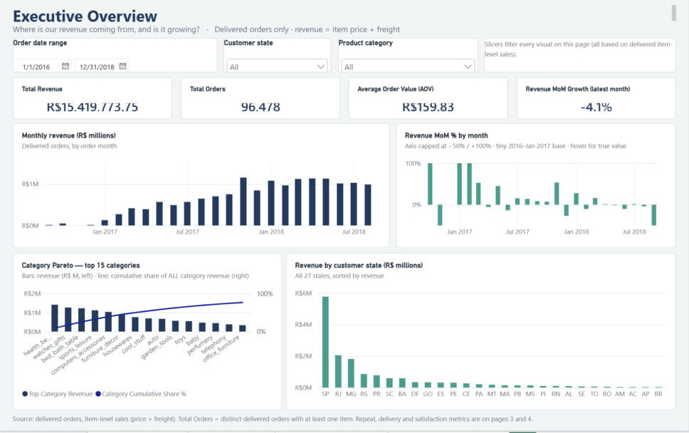
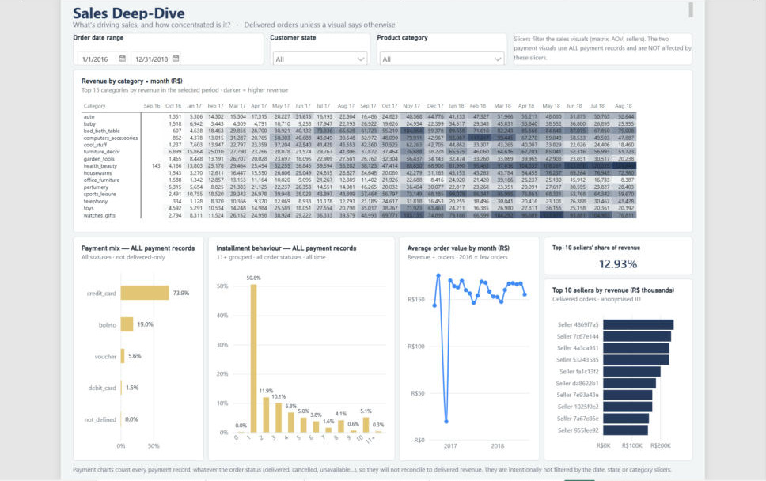
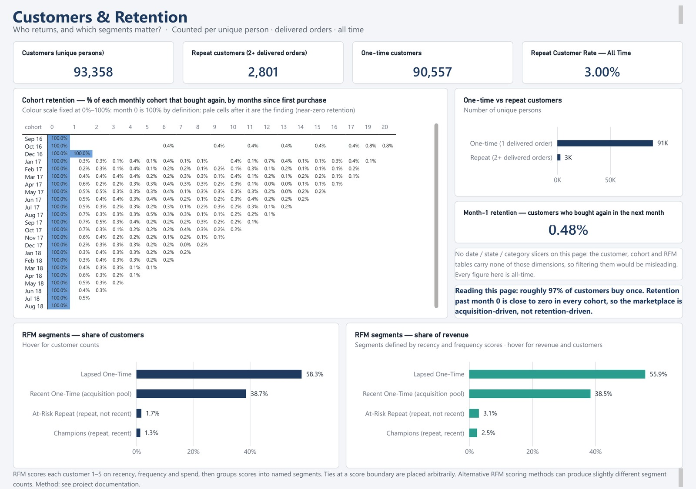
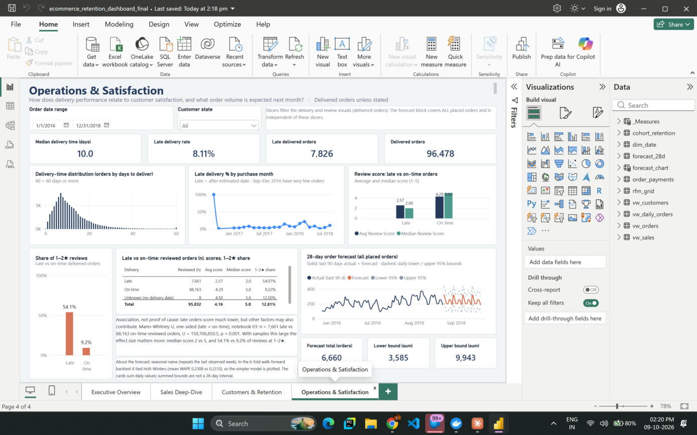
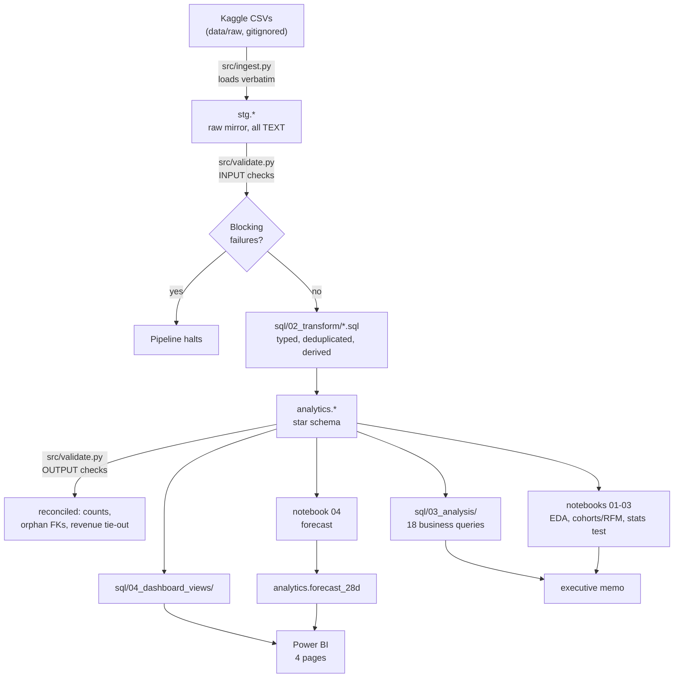

# E-Commerce Revenue & Customer Retention Analytics

[](https://github.com/MARCUS-00/ecommerce-retention-analytics/actions/workflows/ci.yml)
[](requirements.txt)
[](docker-compose.yml)
[](dashboard/ecommerce_retention_dashboard_final.pbix)
[](LICENSE)

An end-to-end analytics project on the Olist Brazilian e-commerce dataset (about 100,000 orders
across 9 relational tables). It covers a PostgreSQL warehouse (staging layer plus star schema), a
validated and idempotent Python pipeline, 18 business-question SQL analyses, a statistical test
of delivery performance against customer satisfaction, a 28-day demand forecast with walk-forward
validation, and a four-page Power BI dashboard.

**What the data says**

- Only **3.00%** of customers (2,801 of 93,358) ever place a second order, so the marketplace
  depends on acquiring new customers rather than retaining existing ones.
- **8.11%** of delivered orders arrive late. Late orders have a median review score of 2/5
  against 5/5 for on-time orders (Mann–Whitney U, p < 0.001). This is an association, not proof
  that lateness causes the low scores.
- Revenue is **R$15.42M** across 96,478 delivered orders. The top 5 of 74 categories earn
  **39.25%** of it; the top 10 sellers earn 12.93%.

## Dashboard

<table>
  <tr>
    <td></td>
    <td></td>
  </tr>
  <tr>
    <td></td>
    <td></td>
  </tr>
</table>

The report is [`dashboard/ecommerce_retention_dashboard_final.pbix`](dashboard/ecommerce_retention_dashboard_final.pbix)
(Power BI Desktop, Windows). It imports four views, three tables and two repository queries from
the local PostgreSQL database, so a refresh needs the Docker container running and the database
password entered in Power BI. The screenshots above show all four pages without needing either.

| Page | Question it answers | Contents |
|---|---|---|
| 1. Executive Overview | Where is revenue coming from, and is it growing? | Revenue, orders, AOV and month-over-month growth cards; monthly revenue; category Pareto; revenue by state; date, state and category slicers |
| 2. Sales Deep-Dive | What drives sales, and how concentrated is it? | Category × month heat matrix; payment mix and instalment behaviour (all payment records); AOV trend; top 10 sellers and their revenue share |
| 3. Customers & Retention | Who returns, and which segments matter? | Customer, repeat and one-time counts; cohort retention matrix; month-1 retention; RFM segment share of customers and of revenue |
| 4. Operations & Satisfaction | How does delivery relate to satisfaction, and what volume is expected? | Delivery-time distribution; late rate by month; review score and 1–2★ share for late vs on-time orders; 28-day order forecast with daily bounds |

## Business problem

Olist is a Brazilian marketplace connecting small sellers to customers. Leadership has three
questions ahead of annual planning:

- **Revenue (CFO):** what drives growth, and where is revenue concentrated and therefore at risk?
- **Retention (CMO):** what share of customers ever return, and which segments deserve targeted spend?
- **Operations (Head of Operations):** does delivery performance measurably affect satisfaction,
  and is the effect statistically significant?

## Key findings

Each finding has a source path and implication in [`docs/findings.md`](docs/findings.md); a one-page
summary with recommendations is in [`docs/insights_memo.md`](docs/insights_memo.md)
([PDF](docs/insights_memo.pdf)).

| # | Finding | Evidence |
|---|---|---|
| 1 | Repeat purchase is rare | 3.00% repeat rate (2,801 / 93,358 customers by `customer_unique_id`); month-1 retention 0.48% (421 / 87,214) |
| 2 | Late delivery goes with lower reviews | Median 2/5 (n = 7,661) vs 5/5 (n = 88,163); 54.1% vs 9.2% of reviews at 1–2★; Mann–Whitney U = 150,706,850.5, p < 0.001 |
| 3 | About 1 in 12 delivered orders is late | 7,826 of 96,478 (8.11%) |
| 4 | Revenue leans on a few categories | Top 5 of 74 categories: 39.25% of delivered revenue |
| 5 | Items-vs-payments gap is explained | 303 of 99,441 orders (0.30%) differ by more than R$0.01 (vouchers, instalments, cancellations); item revenue ties out exactly to staging |
| 6 | The reachable pool is recent one-time buyers | "Recent One-Time" is 38.71% of customers and 38.51% of revenue; "Champions" are 1.29% of customers and 2.52% of revenue |
| 7 | A simple forecast is enough | Seasonal-naive WAPE 0.2308 vs Holt-Winters 0.2310 over 6 folds; 28-day forecast 6,660 orders |

## Technologies

PostgreSQL 16 (Docker) · SQL (CTEs, window functions) · Python 3.12 (pandas, SQLAlchemy,
SciPy, statsmodels, matplotlib) · Jupyter · pytest · GitHub Actions · Power BI Desktop (DAX, 43
measures) · Excel (pivot summary).

## Architecture and data flow



Design decisions that affect how every query should be read (detail in [`docs/architecture.md`](docs/architecture.md)):

- **`customer_id` is per order, not per person.** Retention, repeat-purchase and RFM metrics join
  through `customer_unique_id`; using `customer_id` would make the repeat rate read as about 0%.
- **Two populations, never mixed.** Revenue, retention and RFM use delivered orders; the demand
  forecast uses all placed orders, because capacity planning must cover every order.
- **Staging mirrors the source.** Raw tables load verbatim as text, are checked, and are then
  transformed in SQL; every step can be re-run safely.

## Metric definitions and methodology

- **Revenue** = item price + freight on delivered orders (R$15,419,773.75). **AOV** = revenue ÷
  delivered orders (R$159.83). Payments are a separate population (all payment records, 103,886,
  R$16,008,872.12) and are not expected to equal delivered revenue.
- **Late order:** delivered after the estimated delivery date. The late rate divides by all 96,478
  delivered orders; 8 orders have no delivery date and are never counted as late.
- **Repeat customer:** a unique person with two or more delivered orders. **Month-1 retention** is
  the weighted share of each monthly cohort that buys again in the following month.
- **RFM:** recency, frequency and monetary scores from 1 to 5, grouped into four named segments
  (Champions, At-Risk Repeat, Recent One-Time, Lapsed One-Time). Recency uses `NTILE(5)`, which
  splits customers sharing a boundary date in an order the database does not define; another
  scoring method can move a few customers (1,201 vs 1,204 Champions with `pandas.qcut`), changing
  shares only in the second decimal.
- **Statistical test:** one-sided Mann–Whitney U (late < on-time), chosen because review scores are
  ordinal and skewed. The p-value is reported as p < 0.001; the `0.000e+00` printed by SciPy is
  floating-point underflow, not a probability of zero. With samples this large the effect size
  matters more than the p-value, and the result is an association, not a causal estimate.
- **Forecast:** seasonal-naive baseline against Holt-Winters, scored by WAPE over a 6-fold,
  28-day expanding-window backtest. The baseline is kept because it was not beaten. The daily 95%
  bounds are empirical; their 28-day sums (3,585 and 9,943) are **not** a 28-day prediction
  interval, and the six backtest totals missed by −2,363 to +731 orders.

## Setup and execution

**Prerequisites:** Python 3.11 or 3.12 (3.12 is the tested version; the pinned SciPy 1.13.1 has no
wheels for 3.13 or newer), Docker Desktop, GNU Make, and a Kaggle account with
`~/.kaggle/kaggle.json`. On Windows, install Make with `scoop install make` or, from an elevated
shell, `choco install make -y`.

```bash
make setup             # create .venv and install pinned requirements
cp .env.example .env   # then set DB_PASSWORD; configure the Kaggle API credentials separately
make db-up             # PostgreSQL 16 in Docker
make pipeline          # ingest -> validate -> transform -> validate
make test              # pytest data-quality suite
make analysis          # 18 SQL analyses -> sql/03_analysis/outputs/
make notebooks         # EDA, cohorts/RFM, statistical test, forecast
make views             # Power BI feeding views
make excel             # dashboard/exec_summary.xlsx
```

Step-by-step instructions with troubleshooting are in [`docs/PLAYBOOK.md`](docs/PLAYBOOK.md); a
page-by-page procedure to rebuild the Power BI report is in the
[setup and rebuild guide](docs/guides/OLIST_PROJECT_SETUP_AND_POWER_BI_REBUILD_GUIDE.pdf).

## Testing and verification

- **Automated:** 10 pytest tests cover the staging layer (tables populated, unique keys,
  referential integrity, valid domain values, logged anomalies) and the analytics layer (row
  reconciliation, no orphan foreign keys, revenue tie-out to staging). The GitHub Actions workflow
  runs the pipeline and these tests on every push against small synthetic fixtures
  (`make fixtures`), so it needs no Kaggle credentials; it does not run the notebooks.
- **Numbers:** every figure in this README is reproduced by a query or notebook cited in
  [`docs/findings.md`](docs/findings.md); the saved query results are in `sql/03_analysis/outputs/`.
- **Dashboard:** measures, populations and visuals were checked against the raw data and SQL
  results; the checks, fixes and open items are in
  [`dashboard/BUILD_QA_REPORT.md`](dashboard/BUILD_QA_REPORT.md), and the measure definitions are in
  [`dashboard/DAX_MEASURES_FINAL.md`](dashboard/DAX_MEASURES_FINAL.md).

## Known limitations

- The data covers 2016–2018 from one marketplace. Findings are observational, not causal, and about
  20 months of history limit how confidently seasonality can be modelled.
- Dashboard text about the Mann–Whitney result and the "roughly 97% buy once" note is static and
  does not change on refresh. Repeat rate, cohort and RFM visuals are all-time and ignore the
  date, state and category slicers.
- Late-2016 months have very few orders, so some monthly ratios swing sharply; the pages flag this.
- Accessibility is partial: alt text, tab order and non-colour cues are in place, but a
  screen-reader test and a high-contrast theme check were not done.
- Refreshing the report requires the Docker database; the full list is in the QA report.

## Repository structure

```
sql/01_schema/            DDL: analytics schema and generated dim_date
sql/02_transform/         stg.* -> analytics.* (typed, deduplicated, derived)
sql/03_analysis/          18 business-question queries (+ outputs/ with saved results)
sql/04_dashboard_views/   views that feed Power BI
src/                      ingest, validate, transform, run_pipeline, run_analysis,
                          build_dashboard_views, build_excel_summary, utils
notebooks/                01 EDA, 02 cohorts/RFM, 03 statistical test, 04 forecast
tests/                    input/output data-quality tests and a fixture generator for CI
dashboard/                final .pbix, screenshots/, QA report, DAX measure list, Excel summary,
                          original build specification
docs/                     findings, insights memo, architecture, data dictionary, monitoring
                          policy, PLAYBOOK (run guide), MASTER_DOC (design record), guides/ (PDFs)
data/processed/           forecast_28d.csv
```

## Documentation

| Document | Purpose |
|---|---|
| [`docs/findings.md`](docs/findings.md) | The seven findings with numbers and source paths |
| [`docs/insights_memo.md`](docs/insights_memo.md) | One-page executive memo with recommendations |
| [`docs/architecture.md`](docs/architecture.md), [`docs/data_dictionary.md`](docs/data_dictionary.md) | Pipeline design, revenue definition, schema and anomaly log |
| [`docs/monitoring_policy.md`](docs/monitoring_policy.md) | Forecast acceptance rule, monitoring and limits |
| [`docs/PLAYBOOK.md`](docs/PLAYBOOK.md) | Run the project end to end |
| [`docs/guides/`](docs/guides/) | Setup and Power BI rebuild guide (147 pages), complete project documentation (35 pages) |
| [`docs/MASTER_DOC.md`](docs/MASTER_DOC.md) | Design specification and planning record, written before the build; see its status note |
| [`dashboard/BUILD_QA_REPORT.md`](dashboard/BUILD_QA_REPORT.md), [`dashboard/DAX_MEASURES_FINAL.md`](dashboard/DAX_MEASURES_FINAL.md) | Dashboard checks, limitations and measure list |

## Data source, licence and author

Data: [Brazilian E-Commerce Public Dataset by Olist](https://www.kaggle.com/datasets/olistbr/brazilian-ecommerce)
(Kaggle; credit Olist). It is not redistributed here; `src/ingest.py` downloads it at run time
into the gitignored `data/raw/`. See [`LICENSE`](LICENSE) for the dataset licence note and this
repository's MIT licence for the code.

Author: Manoj Kumar ([@MARCUS-00](https://github.com/MARCUS-00)).
